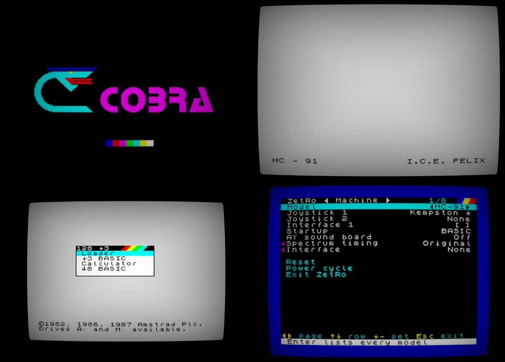

# ZetRo

[Română](README.ro.md)

<p align="center"><picture><source media="(prefers-color-scheme: dark)" srcset="assets/zetro-logo-dark.png"></picture></p>

An emulator of the Z80-based Romanian computers of the 1980s and 1990s: the JET, the HC family, the CIP, the TIM-S, the CoBra,
the aMIC, the PRAE-M and the CUB Z. Each machine is emulated chip by chip and runs its original firmware, unmodified (the
aMIC's with two faults of the archived dump repaired). ZetRo is built for Windows and Linux, on x64 and ARM64; the ARM64
builds have not been tried on real ARM hardware (see the [limitations](docs/NOTES.md#limitations)).



## The machines

| Maker | Models | What they are |
|---|---|---|
| Electromagnetica | JET | A ZX Spectrum 48K-compatible |
| ICE Felix | HC-85, HC-90, HC-91 | Spectrum 48K-compatibles, with the optional Interface 1 (two floppy drives, a serial port, CP/M on the HC-90 and HC-91) |
| ICE Felix | HC-91 Plus (HC-128) | A Spectrum 128-style machine with an AY sound chip |
| ICE Felix | HC-2000 | A Spectrum-compatible with CP/M and two floppy drives |
| ICE Felix | HC-88 | A CP/M computer with a 256 or 512 by 192 colour display and two floppy drives |
| Electronica | CIP-01, CIP-02, CIP-03 | Spectrum-compatibles with 64 KiB of RAM (the CIP-01 loads its BASIC from tape) |
| Electronica | CIP-04 | A ZX Spectrum +3-compatible with a floppy drive, a printer port and a serial port |
| Timisoara | TIM-S | A Spectrum-compatible with 64 KiB of RAM, a CPU switch for 3.5, 6, 7 or 8 MHz, a printer and a serial port |
| Timisoara | TIM-S Plus | A +3-compatible with a 64 KiB video RAM (256, 320, 512 and 640 pixel modes, scrolling), two floppy drives, five serial channels, an AY in stereo and 4 MiB of memory |
| ITCI Brasov | CoBra 64K, CoBra 80K | A Spectrum-compatible with CP/M, four floppy drives and, on the 80K, an 80-column display |
| ICE Felix | CUB Z (monitors 1.4 and 1.3) | A CP/M computer with a 512 by 256 monochrome display, a serial keyboard, two floppy drives and two serial lines |
| ITC Bucuresti | aMIC | A native Z80 computer with a 256 by 256 monochrome display and a tape recorder |
| ITC Cluj-Napoca | PRAE-M (BASIC 3.6 and 3.5) | A native Z80 computer with a 256 by 256 monochrome display and a tape recorder |

The [limitations](docs/NOTES.md#limitations) say what is not known or not emulated. Firmware is never patched. What ZetRo adds to the machines is an option that can be switched off and is marked
as not original: fast tape loading, auto-load, the added interfaces (DivMMC, DivIDE, Dandanator), an AY sound board on the
Spectrum-compatibles and joysticks of other kinds. Cheats, save states, rewind, full speed and the on-screen keyboard are the
program's own.

## Quick start

1. Extract the archive: `ZetRo-<version>-windows-x64.zip` or `-windows-arm64.zip`, or `ZetRo-<version>-linux-x64.tar.gz` or
   `-linux-arm64.tar.gz`.
2. Run `zetro.exe` (Windows) or `./zetro` (Linux) from the extracted folder.

The folder holds the program, `roms/` (the machines' firmware and esxDOS) and `docs/`; the first start writes `zetro.yaml`,
the settings. ZetRo starts on its test screen: press F12 and choose a computer on the Machine page. Then drop a tape on the window, and
ZetRo restarts the machine, types its load command and starts the tape. No software for the machines and no manuals come
with ZetRo: the tapes, disks and cards are your own. [Notes](docs/NOTES.md#using-zetro) tells how to use the tapes, disks,
states, interfaces and ports, and how each machine starts.

`zetro --list-models` names all the machines.

For RetroArch, download the separate [ZetRo Libretro archive](docs/NOTES.md#libretro) for your platform.

On Linux the program needs a 64-bit system with glibc 2.34 or later and the libraries of the desktop SDL talks to: X11 or
Wayland, OpenGL or OpenGL ES, and ALSA or PulseAudio for sound.

## Keys

| Key | |
|---|---|
| F12 | Open and close the setup screen (the machine stands still while it is open) |
| Ctrl+F12 | Switch the machine off and on |
| Alt+F12 | Reset the machine |
| Shift+F12 | Exit |
| Alt+Enter | Full screen |
| Pause | Stop and start the machine |
| Print Screen | Save `zetro-NNNN.png` |
| F11 | Switch the keyboard joystick on and off |
| F10 | The NMI button (the aMIC's INT key; the DivIDE's and DivMMC's esxDOS menu; the Dandanator's button) |
| F9 | Switch between 100% and full speed (no sound at full speed) |
| F8 | Open and close the on-screen keyboard |
| F1 | Choose the tape's file (on a machine with a tape recorder) |
| F5 | Play and stop the tape |
| Shift+F5 | Record on the tape, and stop recording |
| F6, F7 | The previous and the next block of the tape |
| F2 | Save the state to the current slot |
| F3 | Load the state of the current slot |
| F4 (held) | Go back in time |

Every other key is the machine's key in the same place. A file dropped on the window goes into the slot that takes it (a tape,
a disk, a snapshot, a cheat file). What happens (a file inserted, a screenshot saved, the tape's keys) shows for a couple of
seconds on a line over the bottom of the picture.

## The setup screen

F12 opens the setup screen, a ZX Spectrum screen of 32 by 24 characters in its own border, the same for every machine, in
English or Romanian. Left and Right turn the pages, Up and Down select a row, Page Up, Page Down, `+` and `-` change its value,
Enter opens a list or flips a switch, and Esc (or F12) leaves. Every change is written to `zetro.yaml` at once, its comments
kept. The pages:

- **Machine**: the model, picked from every model of every family, and its options (`*` marks what the original machine does
  not have), with Reset, Power cycle and Exit ZetRo. A new model, or a change of an option that needs it, builds the machine
  again when the screen is left (after asking). An option another setting requires is switched on with it and cannot be
  changed until that setting is: starting an HC in CP/M fits its Interface 1.
- **Media**: for each slot of the machine, the file in it, a file picker (it opens in the `media/` folder beside `zetro.yaml`
  and lists the files the slot takes), eject, write protection and fast access. For a tape, Fast loading, Tape sound and
  Auto-load, and the tape blocks: its blocks by name, the one the tape is at marked; Enter seeks to the selected block, `P`
  plays, `S` stops, `R` rewinds and `W` records.
- **Display**: look (plain or the CRT shader), aspect, scale, border (how much of the border around the screen shows: full,
  medium, minimal or none), filter, full screen, vsync and language.
- **Sound**: sound on or off and the volume.
- **Controllers**: what drives each joystick socket (none, the keyboard or a game controller), the keys of the keyboard
  joystick and whether it is on at the start.
- **Ports**: what each serial line and printer of the machine is connected to on the computer ZetRo runs on, and the ports'
  own settings (the serial speed, which channel the connector carries).
- **States**: the ten state slots of the running model, with the date, the time and a small picture of each, snapshot files
  (`.sna`, `.z80`, `.szx`) to load and save.
- **Cheats**: the trainers of the loaded `.pok` file, a switch each.
- **About**: the version and what is new in it.

The screen shows only what the machine has: a drive, a card slot, a port or an option that belongs to an interface that is
not fitted is not listed, an empty joystick socket has no row, and a page with nothing on it (Ports on a machine without
ports, Cheats on one that takes no `.pok` files) is left out. F12 opens the screen on the page it was left on.

A game controller drives the setup screen too: the d-pad or left stick moves and turns the pages, the shoulder buttons change a
value, A is Enter and B is Esc, and Start opens and closes the screen at any time.

## Languages

The setup screen and the messages in the window are in English or Romanian: `ui.language` in `zetro.yaml` (`en` or `ro`), or
the Language row of the Display page, which applies at once. A first start picks Romanian on a system whose user language is
Romanian. This README is also available in [Romanian](README.ro.md).

## Documentation

- [Notes](docs/NOTES.md): using the machines (tapes, disks, ROMs, states, interfaces, ports, how each machine starts,
  scripting), every setting of `zetro.yaml`, the command line, the harness commands and the limitations.
- [Changelog](docs/CHANGELOG.md): what each version changed.
- [Third-party components](docs/THIRD_PARTY.md), with the notices of the ROMs and esxDOS.

## Building from source

On Windows you need Visual Studio 2022 or later with the C++ tools, CMake 3.24 or later, Ninja and Python 3. SDL is downloaded
during the first build.

```
pwsh -File tools/build.ps1
python tools/fetch_roms.py
python tests/verify.py
```

builds `build/x64/zetro.exe` and runs the tests, puts the machines' ROMs in `roms/` and runs the headless checks. The ROMs are
not part of the source: the tool copies them from a checkout of [MiSTerRO](https://github.com/md0-code/misterro), the MiSTer cores' repository, beside this one (with its assets in place) and downloads esxDOS from its own
site, or takes them all from a release archive with `python tools/fetch_roms.py --archive ZetRo-<version>-windows-x64.zip`. `pwsh -File tools/build.ps1 -Arch arm64` builds for Windows on ARM when the Visual Studio ARM64 C++ tools are installed.
`pwsh -File tools/build_dist.ps1` makes the release archive in `dist/releases/`.

On Linux (Debian 12, WSL included), `tools/build_linux.sh` builds, tests and packages the x64 and ARM64 programs; its header
lists the packages it needs.

Build the Libretro core with `tools/build.ps1 -Libretro` on Windows. To make the core archives, use
`tools/build_dist.ps1 -Libretro` on Windows or `tools/build_linux.sh all --libretro` on Linux.

## License

GPL-3.0-or-later (`docs/LICENSE`). Third-party components are listed in `docs/THIRD_PARTY.md`.
