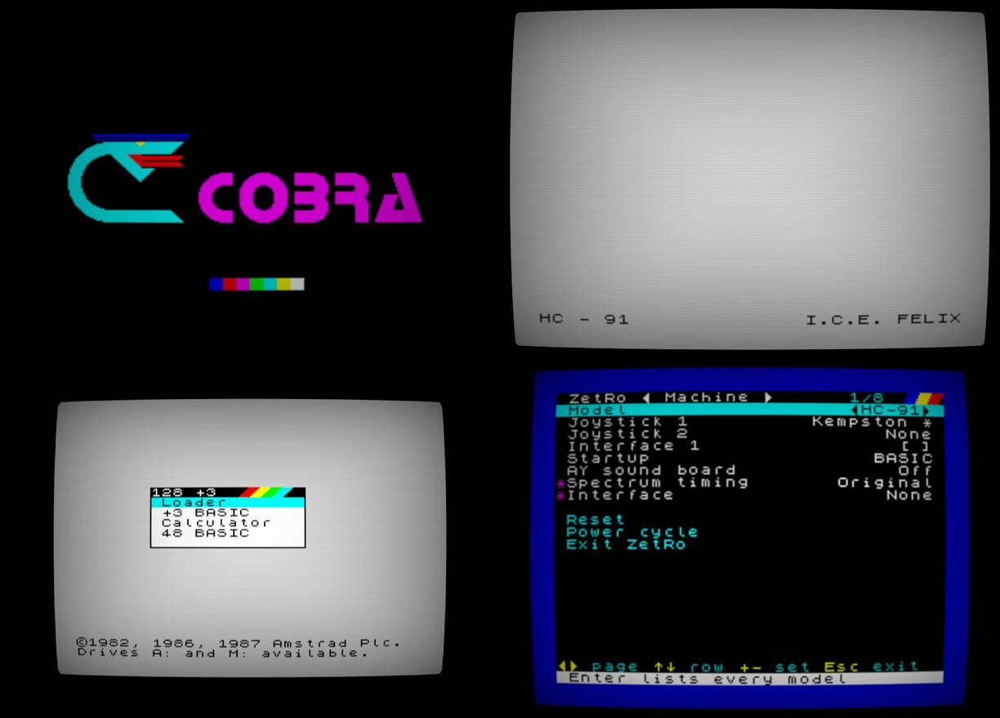

# ZetRo

[English](README.md)

<p align="center"><picture><source media="(prefers-color-scheme: dark)" srcset="assets/zetro-logo-dark.png"></picture></p>

Emulator al calculatoarelor românești cu microprocesor Z80 din anii 1980 și 1990: JET, familia HC, CIP, TIM-S, CoBra, aMIC,
PRAE-M și CUB Z. Fiecare calculator este emulat circuit cu circuit și rulează programul său original (firmware), nemodificat
(cel al aMIC-ului cu două defecte ale copiei arhivate reparate). ZetRo se compilează pentru Windows și pentru Linux, pe x64 și
pe ARM64; variantele ARM64 nu au fost încercate pe echipament ARM real (vezi [limitările](docs/NOTES.md#limitations), în
engleză).



## Calculatoarele

| Producător | Modele | Ce sunt |
|---|---|---|
| Electromagnetica | JET | Compatibil ZX Spectrum 48K |
| ICE Felix | HC-85, HC-90, HC-91 | Compatibile Spectrum 48K, cu Interfața 1 opțională (două unități de dischetă, port serial, CP/M pe HC-90 și HC-91) |
| ICE Felix | HC-91 Plus (HC-128) | Calculator în stilul Spectrum 128, cu circuit de sunet AY |
| ICE Felix | HC-2000 | Compatibil Spectrum cu CP/M și două unități de dischetă |
| ICE Felix | HC-88 | Calculator CP/M cu ecran color de 256 sau 512 pe 192 și două unități de dischetă |
| Electronica | CIP-01, CIP-02, CIP-03 | Compatibile Spectrum cu 64 Kocteți de RAM (CIP-01 își încarcă BASIC-ul de pe casetă) |
| Electronica | CIP-04 | Compatibil ZX Spectrum +3 cu o unitate de dischetă, port de imprimantă și port serial |
| Timișoara | TIM-S | Compatibil Spectrum cu 64 Kocteți de RAM, comutator de procesor pentru 3,5, 6, 7 sau 8 MHz, port de imprimantă și port serial |
| Timișoara | TIM-S Plus | Compatibil +3 cu memorie video de 64 Kocteți (moduri de 256, 320, 512 și 640 de puncte, derulare), două unități de dischetă, cinci canale seriale, AY stereo și 4 Mocteți de memorie |
| ITCI Brașov | CoBra 64K, CoBra 80K | Compatibil Spectrum cu CP/M, patru unități de dischetă și, la 80K, ecran de 80 de coloane |
| ICE Felix | CUB Z (monitoare 1.4 și 1.3) | Calculator CP/M cu ecran monocrom de 512 pe 256, tastatură serială, două unități de dischetă și două linii seriale |
| ITC București | aMIC | Calculator Z80 nativ cu ecran monocrom de 256 pe 256 și casetofon |
| ITC Cluj-Napoca | PRAE-M (BASIC 3.6 și 3.5) | Calculator Z80 nativ cu ecran monocrom de 256 pe 256 și casetofon |

[Limitările](docs/NOTES.md#limitations) (în engleză) arată ce nu
se cunoaște sau nu este emulat. Programul original nu este niciodată modificat. Ce adaugă ZetRo calculatoarelor este o opțiune
care se poate dezactiva și este marcată ca neoriginală: încărcarea rapidă a casetei, încărcarea automată, interfețele adăugate
(DivMMC, DivIDE, Dandanator), placa de sunet AY la compatibilele Spectrum și manetele de alte tipuri. Poke-urile, salvările,
derularea înapoi, viteza maximă și tastatura de pe ecran sunt ale programului.

## Pornire rapidă

1. Se extrage arhiva: `ZetRo-<versiune>-windows-x64.zip` sau `-windows-arm64.zip`, ori `ZetRo-<versiune>-linux-x64.tar.gz` sau
   `-linux-arm64.tar.gz`.
2. Se rulează `zetro.exe` (Windows) sau `./zetro` (Linux) din folderul extras.

Folderul conține programul, `roms/` (programele calculatoarelor și esxDOS) și `docs/`; la prima pornire se scrie
`zetro.yaml`, cu setările. ZetRo pornește pe ecranul de test: se apasă F12 și se alege un calculator pe pagina Calculator. Apoi se trage o casetă peste
fereastră, iar ZetRo repornește calculatorul, tastează comanda de încărcare și pornește caseta. ZetRo nu vine cu programe
pentru calculatoare și nici cu manuale: casetele, dischetele și cardurile sunt ale utilizatorului. [Notele](docs/NOTES.ro.md) arată
cum se folosesc casetele, dischetele, salvările, interfețele și porturile și cum pornește fiecare calculator.

`zetro --list-models` numește toate calculatoarele.

Pentru RetroArch, se descarcă [arhiva separată ZetRo Libretro](docs/NOTES.md#libretro) pentru platforma folosită.

Pe Linux programul are nevoie de un sistem pe 64 de biți cu glibc 2.34 sau mai nou și de bibliotecile pe care le folosește SDL:
X11 sau Wayland, OpenGL sau OpenGL ES, ALSA sau PulseAudio pentru sunet.

## Taste

| Tastă | |
|---|---|
| F12 | Deschide și închide ecranul de configurare (calculatorul stă pe loc cât timp este deschis) |
| Ctrl+F12 | Oprește și pornește calculatorul |
| Alt+F12 | Resetează calculatorul |
| Shift+F12 | Ieșire |
| Alt+Enter | Ecran complet |
| Pause | Oprește și pornește calculatorul |
| Print Screen | Salvează `zetro-NNNN.png` |
| F11 | Pornește și oprește maneta de la tastatură |
| F10 | Butonul NMI (tasta INT a aMIC-ului; meniul esxDOS al DivIDE și DivMMC; butonul Dandanator) |
| F9 | Comută între 100% și viteza maximă (fără sunet la viteza maximă) |
| F8 | Deschide și închide tastatura de pe ecran |
| F1 | Alege fișierul casetei (la un calculator cu casetofon) |
| F5 | Pornește și oprește caseta |
| Shift+F5 | Înregistrează pe casetă și oprește înregistrarea |
| F6, F7 | Blocul anterior și blocul următor al casetei |
| F2 | Salvează starea în poziția curentă |
| F3 | Încarcă starea din poziția curentă |
| F4 (apăsată) | Întoarcere în timp |

Orice altă tastă este tasta calculatorului din același loc. Un fișier tras peste fereastră ajunge în poziția care îl primește (o
casetă, o dischetă, un instantaneu, un fișier de poke-uri). Ce se întâmplă (un fișier introdus, un ecran salvat, tastele casetei)
apare câteva secunde pe o linie deasupra marginii de jos a imaginii.

## Ecranul de configurare

F12 deschide ecranul de configurare, un ecran ZX Spectrum de 32 pe 24 de caractere în chenarul său, la fel pentru toate
calculatoarele, în engleză sau în română. Stânga și Dreapta schimbă paginile, Sus și Jos aleg un rând, Page Up, Page Down, `+`
și `-` schimbă valoarea, Enter deschide o listă sau comută un întrerupător, iar Esc (sau F12) iese. Fiecare schimbare se scrie
imediat în `zetro.yaml`, cu comentariile păstrate. Paginile:

- **Calculator**: modelul, ales dintre toate modelele tuturor familiilor, și opțiunile lui (`*` marchează ce nu avea calculatorul
  original), cu Reset, Repornire și Ieșire din ZetRo. Un model nou, sau o schimbare de opțiune care o cere, reconstruiește
  calculatorul la ieșirea din ecran (după o întrebare). O opțiune cerută de altă setare este pornită odată cu ea și nu poate fi
  schimbată cât timp setarea rămâne: pornirea unui HC în CP/M îi montează Interfața 1.
- **Media**: pentru fiecare poziție a calculatorului, fișierul din ea, un selector de fișiere (se deschide în folderul
  `media/` de lângă `zetro.yaml` și arată fișierele pe care le primește poziția), scoatere, protecție la scriere și acces
  rapid. Pentru casetă, Încărcare rapidă, Sunet casetă și Încărcare automată, apoi blocurile ei: după nume, cu cel la care se
  află caseta marcat; Enter caută blocul ales, `P` pornește, `S` oprește, `R` derulează înapoi și `W` înregistrează.
- **Ecran**: aspectul (simplu sau cu shader-ul CRT), forma, scara, bordura (cât din bordura din jurul ecranului se vede:
  completă, medie, minimă sau fără), filtrul, ecran complet, sincronizarea verticală și limba.
- **Sunet**: sunetul pornit sau oprit și volumul.
- **Controlere**: ce comandă fiecare soclu de manetă (nimic, tastatura sau un controler de joc), tastele manetei de la
  tastatură și dacă este pornită de la început.
- **Porturi**: la ce este conectată, pe calculatorul pe care rulează ZetRo, fiecare linie serială și fiecare imprimantă, și
  setările proprii ale porturilor (viteza serială, canalul dus de conector).
- **Salvări**: cele zece poziții de salvare ale modelului care rulează, cu data, ora și o imagine mică pentru fiecare, fișiere de
  instantanee (`.sna`, `.z80`, `.szx`) de încărcat și de salvat.
- **Poke-uri**: poke-urile fișierului `.pok` încărcat, câte un întrerupător pentru fiecare.
- **Despre**: versiunea și ce este nou în ea.

Ecranul arată numai ce are calculatorul: o unitate, un card, un port sau o opțiune a unei interfețe care nu este montată nu apar,
un soclu de manetă gol nu are rând, iar o pagină fără nimic pe ea (Porturi la un calculator fără porturi, Poke-uri la unul care
nu primește fișiere `.pok`) lipsește. F12 deschide ecranul pe pagina pe care a fost închis.

Un controler de joc comandă și ecranul de configurare: crucea direcțională sau joystick-ul stâng mută și schimbă paginile,
butoanele de umăr schimbă valoarea, A este Enter și B este Esc, iar Start deschide și închide ecranul oricând.

## Limbi

Ecranul de configurare și mesajele din fereastră sunt în engleză sau în română: `ui.language` în `zetro.yaml` (`en` sau `ro`),
ori rândul Limbă al paginii Ecran, care se aplică imediat. La prima pornire se alege româna pe un sistem a cărui limbă de
utilizator este româna. Acest fișier este disponibil și în [engleză](README.md).

## Documentație

- [Note](docs/NOTES.ro.md): folosirea calculatoarelor (casete, dischete, ROM-uri, salvări, interfețe, porturi, pornirea
  fiecărui calculator, comenzi din script); setările din `zetro.yaml`, linia de comandă și limitările sunt în
  [versiunea engleză](docs/NOTES.md).
- [Istoricul versiunilor](docs/CHANGELOG.md) (în engleză).
- [Componente terțe](docs/THIRD_PARTY.md) (în engleză), cu notele ROM-urilor și ale esxDOS.

## Compilare din sursă

Pe Windows este nevoie de Visual Studio 2022 sau mai nou cu uneltele C++, CMake 3.24 sau mai nou, Ninja și Python 3. SDL se
descarcă la prima compilare.

```
pwsh -File tools/build.ps1
python tools/fetch_roms.py
python tests/verify.py
```

compilează `build/x64/zetro.exe` și rulează testele, pune ROM-urile calculatoarelor în `roms/` și rulează verificările fără
fereastră. ROM-urile nu fac parte din sursă: unealta le copiază dintr-o copie a depozitului [MiSTerRO](https://github.com/md0-code/misterro), cel al nucleelor MiSTer, aflată lângă acesta (cu resursele sale puse la loc), și descarcă esxDOS
de pe site-ul lui, sau le ia pe toate dintr-o arhivă de distribuție cu
`python tools/fetch_roms.py --archive ZetRo-<versiune>-windows-x64.zip`. `pwsh -File tools/build.ps1 -Arch arm64` compilează pentru Windows pe ARM când sunt instalate uneltele C++ ARM64 ale
Visual Studio. `pwsh -File tools/build_dist.ps1` face arhiva de distribuție în `dist/releases/`.

Pe Linux (Debian 12, inclusiv WSL), `tools/build_linux.sh` compilează, testează și împachetează programele x64 și ARM64; începutul
lui listează pachetele de care are nevoie.

Comanda `tools/build.ps1 -Libretro` compilează nucleul Libretro pe Windows. Arhivele se fac cu
`tools/build_dist.ps1 -Libretro` pe Windows sau `tools/build_linux.sh all --libretro` pe Linux.

## Licență

GPL-3.0-or-later (`docs/LICENSE`). Componentele terțe sunt listate în `docs/THIRD_PARTY.md`.
